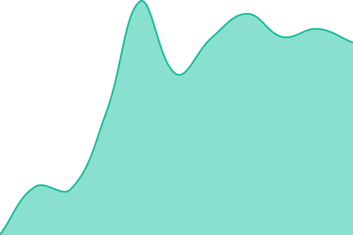
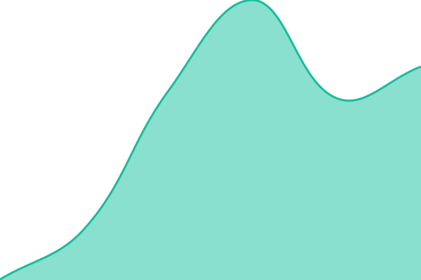
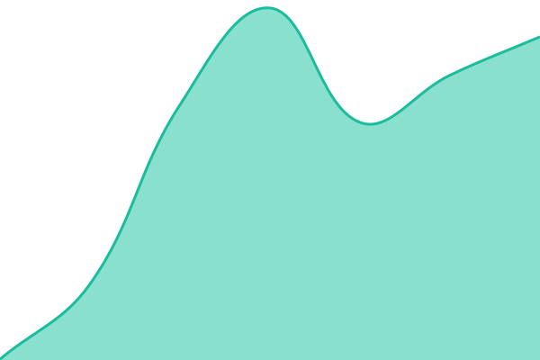
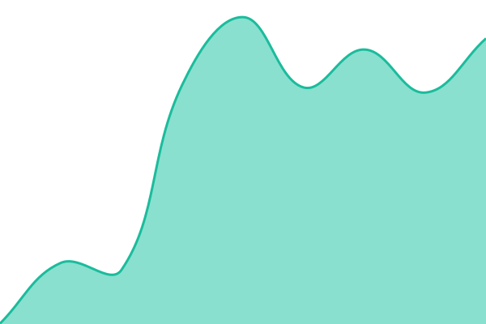

# [📈 Live Status](https://onekivo.github.io/status): <!--live status--> **🟩 All systems operational**

This repository contains the open-source uptime monitor and status page for [KIVO](https://onekivo.com), powered by [Upptime](https://github.com/upptime/upptime).

With [Upptime](https://upptime.js.org), you can get your own unlimited and free uptime monitor and status page, powered entirely by a GitHub repository. We use [Issues](https://github.com/onekivo/status/issues) as incident reports, [Actions](https://github.com/onekivo/status/actions) as uptime monitors, and [Pages](https://onekivo.github.io/status) for the status page.

<!--start: status pages-->
<!-- This summary is generated by Upptime (https://github.com/upptime/upptime) -->
<!-- Do not edit this manually, your changes will be overwritten -->
<!-- prettier-ignore -->
| URL | Status | History | Response Time | Uptime |
| --- | ------ | ------- | ------------- | ------ |
|  [App](https://app.onekivo.com/api/health) | 🟩 Up | [app.yml](https://github.com/onekivo/status/commits/HEAD/history/app.yml) | 

 474ms
     
 | 

<a href="https://onekivo.github.io/status/history/app">100.00%</a>
    

|  [App: database](https://app.onekivo.com/api/health) | 🟩 Up | [app-database.yml](https://github.com/onekivo/status/commits/HEAD/history/app-database.yml) | 

 339ms
     
 | 

<a href="https://onekivo.github.io/status/history/app-database">100.00%</a>
    

|  [App: job queue](https://app.onekivo.com/api/health) | 🟩 Up | [app-queue.yml](https://github.com/onekivo/status/commits/HEAD/history/app-queue.yml) | 

 338ms
     
 | 

<a href="https://onekivo.github.io/status/history/app-queue">100.00%</a>
    

|  [App: file storage](https://app.onekivo.com/api/health) | 🟩 Up | [app-storage.yml](https://github.com/onekivo/status/commits/HEAD/history/app-storage.yml) | 

 347ms
     
 | 

<a href="https://onekivo.github.io/status/history/app-storage">100.00%</a>
    

|  [App: encrypted fields](https://app.onekivo.com/api/health) | 🟩 Up | [app-kms.yml](https://github.com/onekivo/status/commits/HEAD/history/app-kms.yml) | 

 336ms
     
 | 

<a href="https://onekivo.github.io/status/history/app-kms">100.00%</a>
    

|  [App: email sending](https://app.onekivo.com/api/health) | 🟩 Up | [app-mail.yml](https://github.com/onekivo/status/commits/HEAD/history/app-mail.yml) | 

 351ms
     
 | 

<a href="https://onekivo.github.io/status/history/app-mail">100.00%</a>
    

|  [Background jobs](https://worker.onekivo.com/health) | 🟩 Up | [worker.yml](https://github.com/onekivo/status/commits/HEAD/history/worker.yml) | 

 455ms
     
 | 

<a href="https://onekivo.github.io/status/history/worker">100.00%</a>
    

|  [Website](https://onekivo.com/) | 🟩 Up | [website.yml](https://github.com/onekivo/status/commits/HEAD/history/website.yml) | 

 441ms
     
 | 

<a href="https://onekivo.github.io/status/history/website">100.00%</a>
    

|  [Short links and QR codes](https://qr.onekivo.com/healthz) | 🟩 Up | [qr.yml](https://github.com/onekivo/status/commits/HEAD/history/qr.yml) | 

 474ms
     
 | 

<a href="https://onekivo.github.io/status/history/qr">100.00%</a>
    

<!--end: status pages-->

[**Visit our status website →**](https://onekivo.github.io/status)

## 📄 License

- Code: [MIT](./LICENSE) © [Anand Chowdhary](https://anandchowdhary.com)
- Data in the `./history` directory: [Open Database License](https://opendatacommons.org/licenses/odbl/1-0/)
